# Changelog

Every PhoneDesk version, newest first. Each version heading links to its page on
[GitHub Releases](https://github.com/icdmkg2/phonedesk/releases), where the installer is attached (newest version) and
the same notes are shown. Releases are published from this file by `.github/workflows/release.yml`.

Screenshots of interface changes are in [`docs/changelog/`](docs/changelog/). They were taken from each version as it
was released, with a made-up song (*Paper Lanterns* by *Harbor Lights*) and original placeholder lyrics.

## [1.8.1] — 2026-11-09

Fixes for first-run setup and updates.

## Fixed
- The first-run setup's *Connect your phone* step kept showing *Waiting for your phone…* after a phone had connected.
  It now shows the phone's name and how it is connected, and the button changes to *Next*.
- **Updates:** *Check for updates* showed *Couldn't update: Failed to execute 'json' on 'Response': Unexpected end of JSON
  input* whenever the check ended without a newer version (up to date, off, running from source). The check now always
  answers, and the status says what it found.
- An update whose installer didn't start no longer leaves *Installing* on screen: it shows the problem and lets you try
  again.

## Changed
- The website has a new look (the *Website* screenshot in the 1.8.0 notes now shows it).

## [1.8.0] — 2026-11-08

Clock faces, your calendar, night mode, an hour of PC stats, and a website.

### Added
- **Clock faces:** *Digital* (time, date, weather), *Analog* (a clock face beside the date) and *Big* (just the time,
  as large as the screen allows), under *Phone display → Clock screen*.
- **5-day forecast** under the clock: day, icon, high and low (Open-Meteo, as before).
- **Your calendar beside the clock:** paste a private iCal address from Google Calendar, Outlook or iCloud and the
  next events of the coming week show in an *Up next* panel, with the one happening now highlighted. Repeating events,
  all-day events, time zones and cancelled or skipped dates are handled. The address stays on the PC (removed from
  diagnostics too); only the next few events go to the phone.
- **Night mode:** off, on a schedule (e.g. 22:00–07:00) or *when it's dark* (the phone app's light sensor). At night
  the phone goes black with a dim clock, red if you like, switches to the clock, and the phone app turns the screen's
  own brightness down. It switches back in the morning.
- **Burn-in protection** (on by default): everything moves a few pixels every 3 minutes, slowly, so a screen that's
  always on doesn't keep a ghost image.
- **PC stats, rebuilt:** a *Network* card (download speed, upload under it), a **last hour graph** of CPU, memory and
  GPU (the PC keeps the history even while no phone is watching), and a bar for **every CPU thread**. The PC name and
  uptime moved to the top, clear of the battery pill.
- **What's new:** after an update, the PhoneDesk window shows that version's notes once (they ship with the app).
  Click the version number at the bottom left to see them again.
- **Save diagnostics** (*Activity*): one zip with the logs, settings and system facts for a bug report. Keys, tokens,
  the calendar address and shortcut commands are left out. *Report a problem* opens the new issue forms.
- **Website** at [phonedesk.orreinis.me](https://phonedesk.orreinis.me/) with every feature, the lyrics
  styles, setup help and this changelog with its screenshots.
- **Phone app in the release:** each release has `PhoneDesk-x.y.z.apk` attached. When the signing key is stored as a
  repository secret, the release workflow also rebuilds the app; its version now follows PhoneDesk's.
- **Build check** for pull requests: JavaScript syntax, the phone app and the installer are built on Windows.
- Issue forms for bug reports and feature requests; the README shows screenshots.

### Fixed
- The README's build command was broken (`build\build.ps1` had lost a character).

### Screenshots

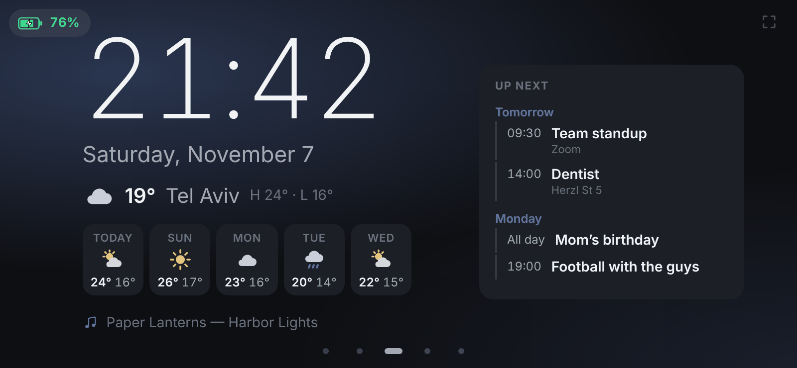
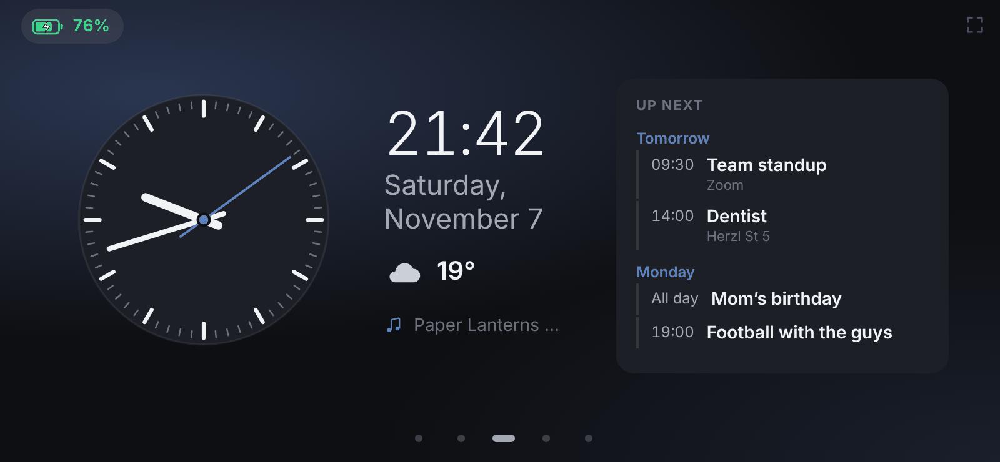

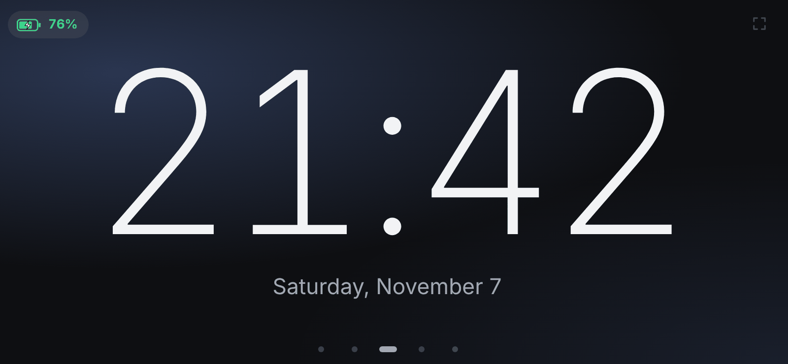
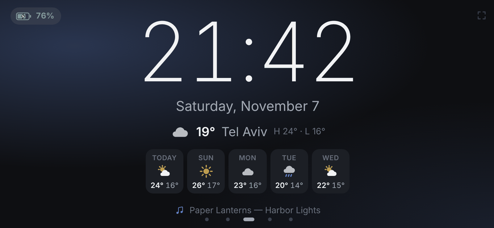

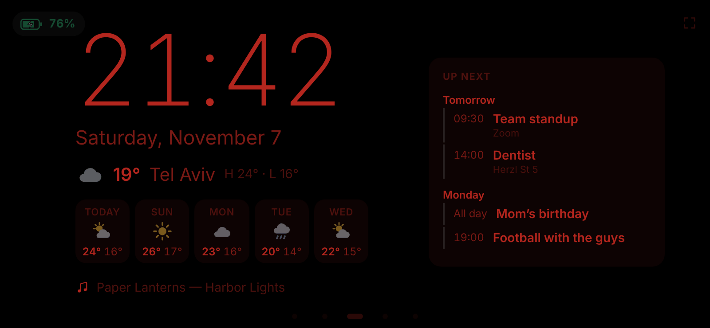
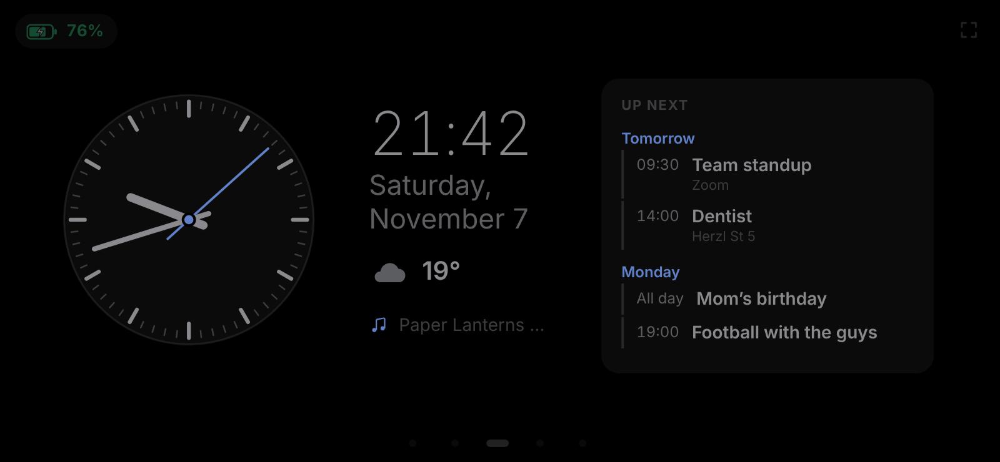

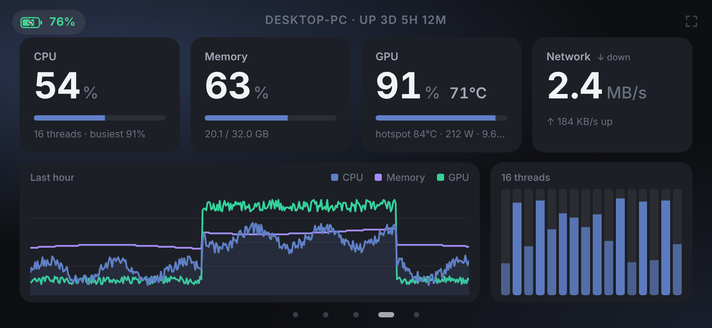

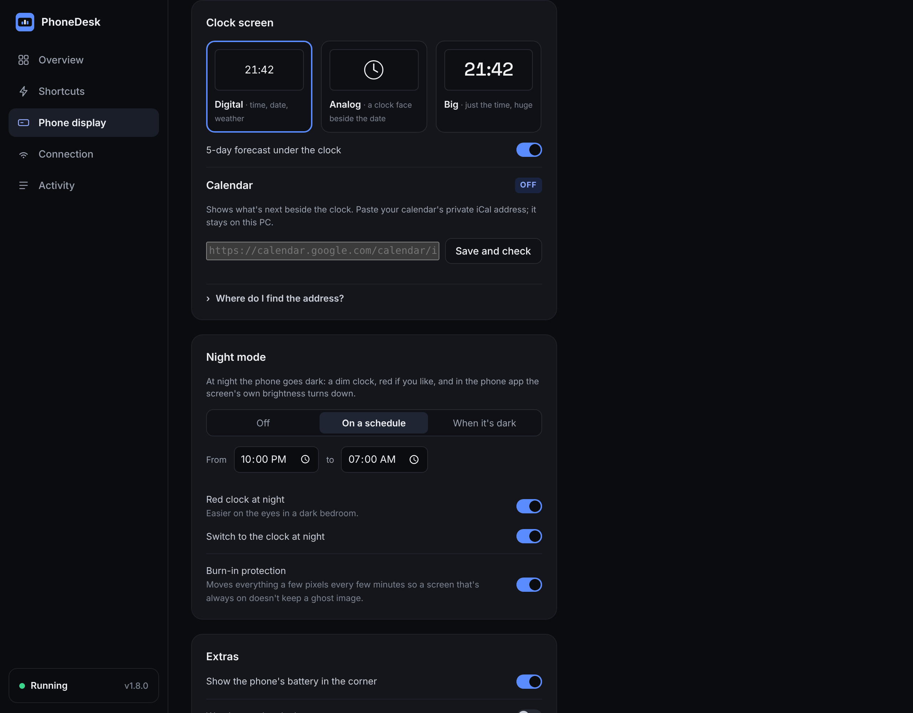
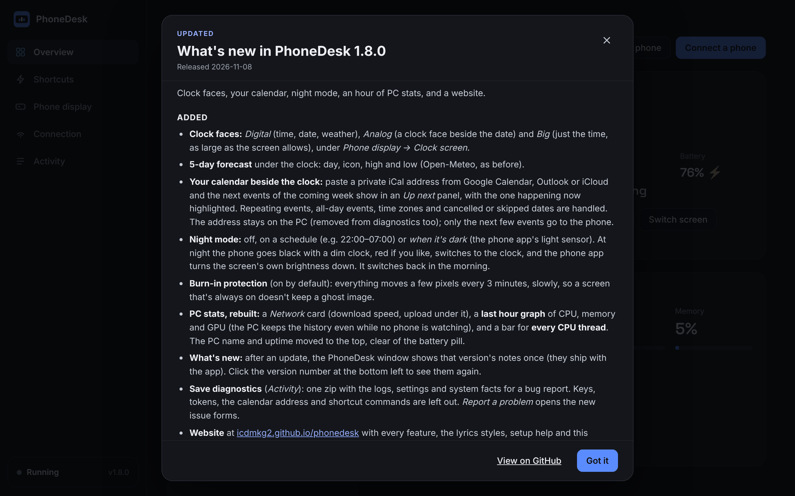

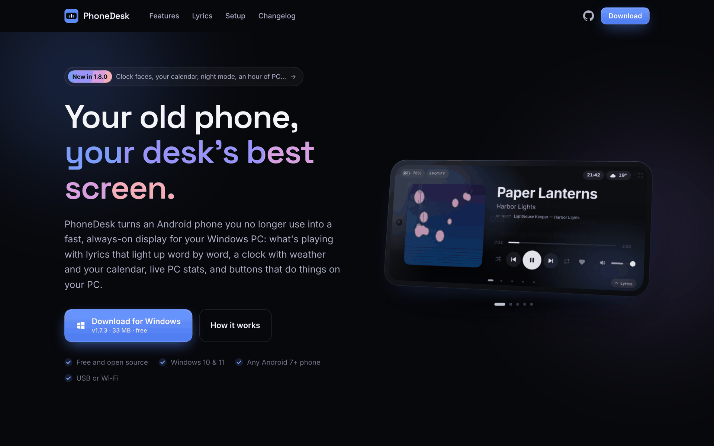

## [1.7.3] — 2026-11-08

Updates work out of the box.

### Changed
- **Official releases by default:** PhoneDesk now updates from
  [icdmkg2/phonedesk](https://github.com/icdmkg2/phonedesk/releases) without any setup. Existing installs with an
  empty *GitHub repository* field switch to it too; a fork you entered is kept.
- An empty *GitHub repository* field means the official releases; turn off **Check automatically** to stop updates.
  The field explains this under it.

### Screenshots
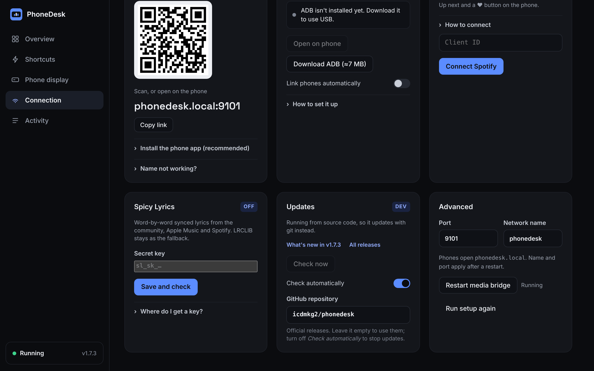

## [1.7.2] — 2026-11-08

Release notes, linked from the app.

### Added
- **Patch notes for every version** in `CHANGELOG.md`, with screenshots of interface changes, and a matching
  [GitHub Release](https://github.com/icdmkg2/phonedesk/releases) per version.
- **Release links in the app:** *Connection → Updates* now has **What's new in vX.Y.Z** (the release page of the
  version you run, or of the update that's ready to install) and **All releases**. Links open in your browser.
- Automatic releases: when the version in `package.json` changes on `main`, GitHub Actions builds
  `PhoneDesk-Setup-x.y.z.exe` (+ `.sha256`) on Windows and publishes the release with the notes from this file, so the
  in-app updater finds it. Editing this file refreshes the notes of existing releases.

### Changed
- The updater keeps the release page address of a downloaded update, so the link goes straight to its notes.

### Screenshots
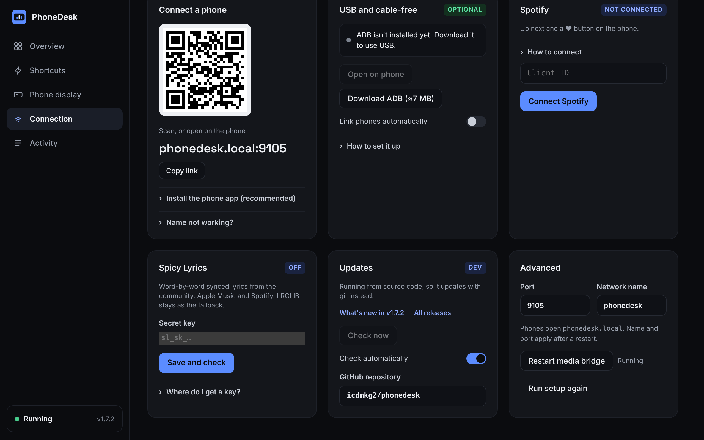

## [1.7.1] — 2026-11-08

Word-by-word lyrics from Spicy Lyrics. (This version's commit is titled "1.7.0"; it shipped as 1.7.1.)

### Added
- **Spicy Lyrics as the first lyrics source**, when you add a key: community word-by-word syncs first, then Apple
  Music and Spotify lyrics. LRCLIB stays as the fallback, and is used when Spicy Lyrics has nothing, is rate-limited or
  is down (it's then left alone for a while).
- New **Spicy Lyrics** card under *Connection*: paste your secret key (`sl_sk_…`), **Save and check** tests it, and
  "Where do I get a key?" explains how. The key stays on the PC; phones never see it. The card shows where the current
  lyrics came from.
- **Real word timings:** with word-synced lyrics, each word fills exactly while it's sung, in the scrolling and
  Kinetic styles, and lines last as long as they're actually sung.
- **Lyrics credit** (required by the providers): "Lyrics: Spicy Lyrics · uploaded by … · made by …" under the cover
  in scrolling lyrics, and along the bottom in Kinetic.

### Changed
- The exact recording is matched by length (within 4 s) across its releases, so the timings fit the version playing.
- Only the title, artist, album and length are sent to the lyrics services.

### Screenshots

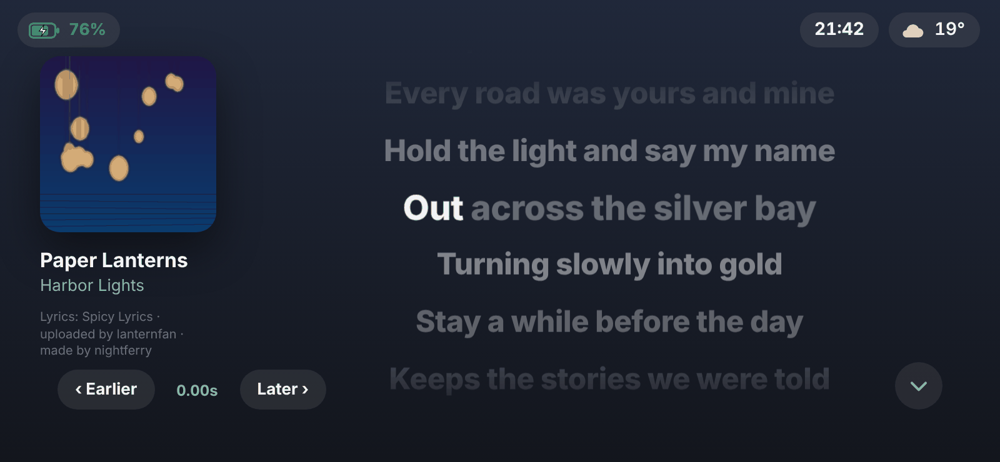
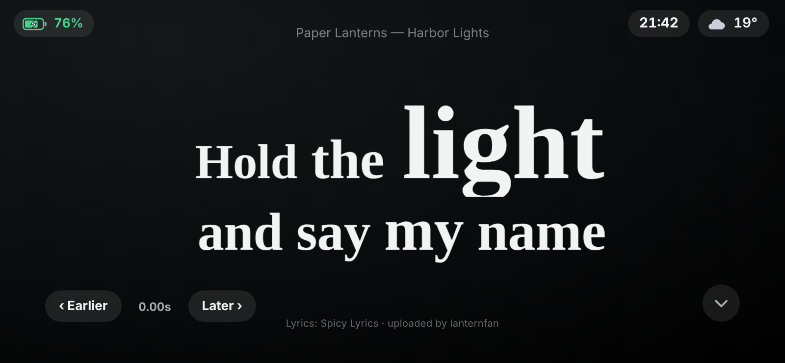

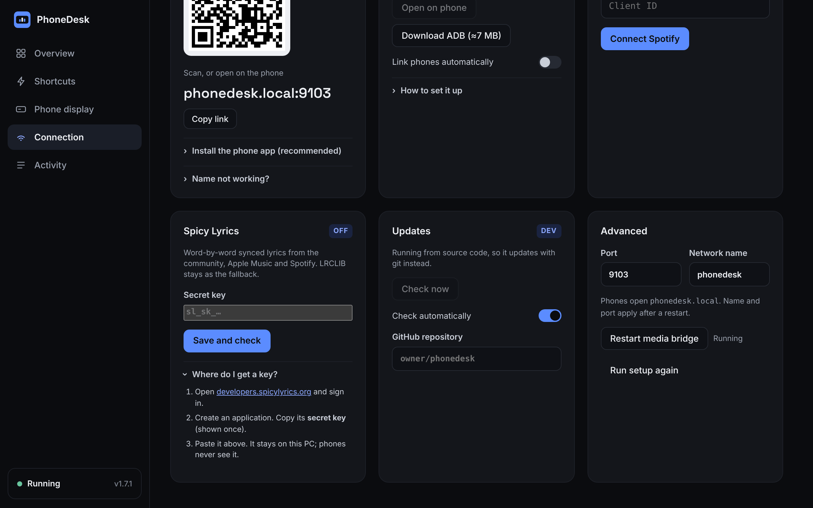

## [1.6.4] — 2026-11-08

### Added
- **Melody indicator:** dancing bars with a label while music plays but nobody sings: **Intro**, **Instrumental**
  (breaks) and **Outro**, and for songs with no lyrics (**No lyrics for this song**, **Instrumental**, **Looking for
  lyrics…**). The bars pause with the song, and the lyrics fade back while they show.

### Changed
- Kinetic lines clear sooner after they're sung (1.2 s instead of 3.2 s) when a gap follows.

### Screenshots

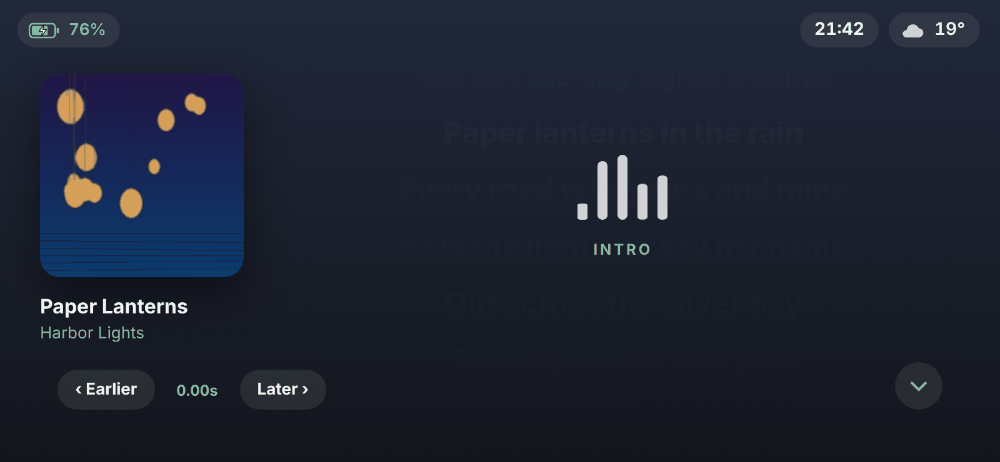
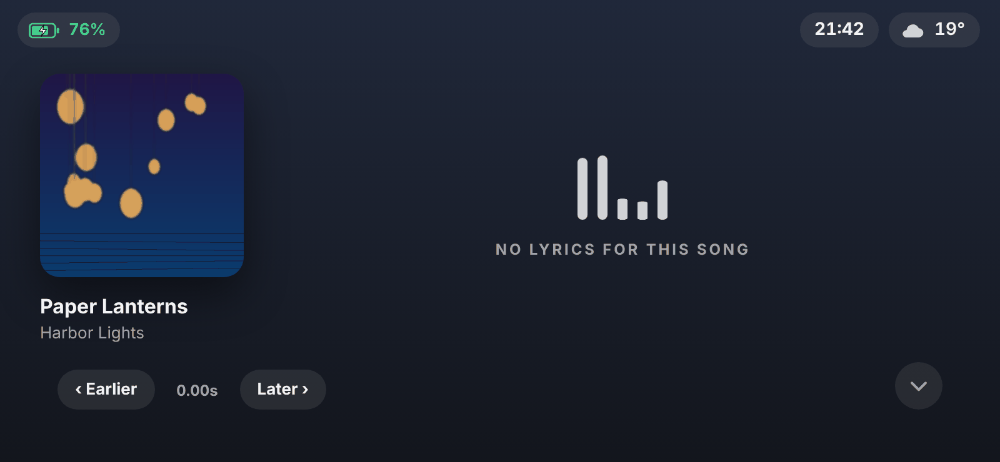

## [1.6.3] — 2026-11-08

### Changed
- **Fast reconnect:** a connection attempt gives up after 3 s and the next try comes sooner (at most every 2.5 s);
  returning to the page reconnects at once. The phone app checks the PC every 5 s (was 15 s) and pokes the page as
  soon as the PC is back.
- **Lyrics timing:** lines light 0.4 s early (was 0.25 s); Earlier/Later move in 0.15 s steps up to ±5 s, and the
  current shift is shown between the buttons (e.g. `+0.30s`).

### Fixed
- Reading the volume no longer fails now and then with "Unable to cast … MMDeviceEnumeratorComObject".

### Screenshots
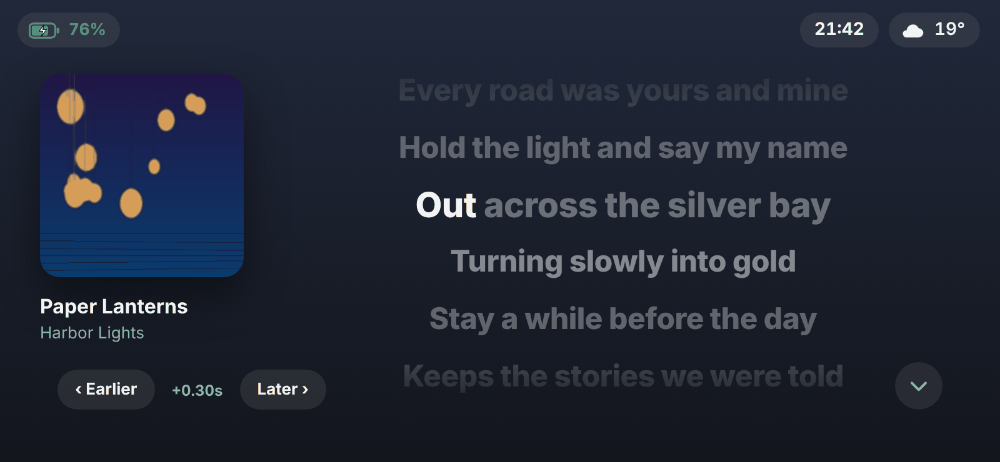

## [1.6.1] — 2026-11-07

Plain (unsynced) lyrics now scroll, and the scrolling lyrics view gets a cover column.

### Added
- **Estimated timing for plain lyrics:** when LRCLIB only has unsynced text, the lines are spread over the song by
  their length, so they still scroll and light up. The view says *Estimated timing*; the Earlier/Later buttons
  fine-tune it.
- **Cover column** in the scrolling lyrics view: album art, title and artist on the left, lyrics on the right.

### Screenshots

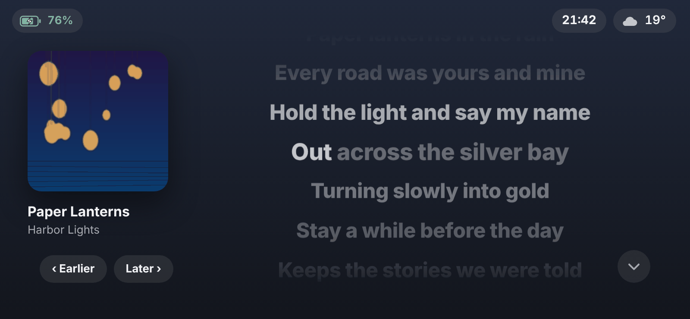
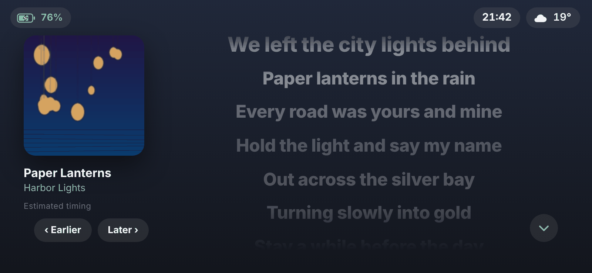

## [1.6.0] — 2026-11-07

Proper Hebrew fonts.

### Added
- **Bundled Hebrew fonts** (SIL Open Font License, from Google Fonts), so Hebrew looks right on phones without them:
  Heebo for the interface and Sans/Condensed lyrics, Frank Ruhl Libre for Serif lyrics, Rubik for Mono/Script lyrics.
  They apply only to Hebrew letters (`unicode-range`), so Latin text keeps the fonts it had.

### Screenshots

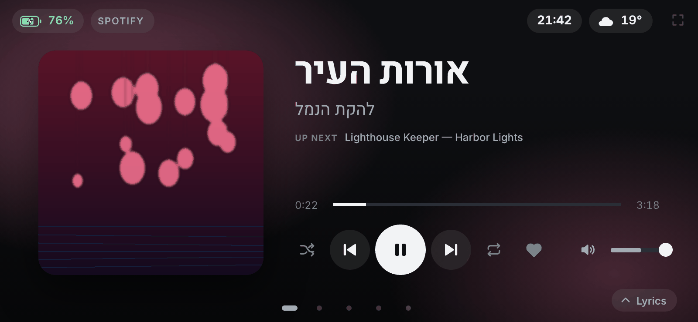
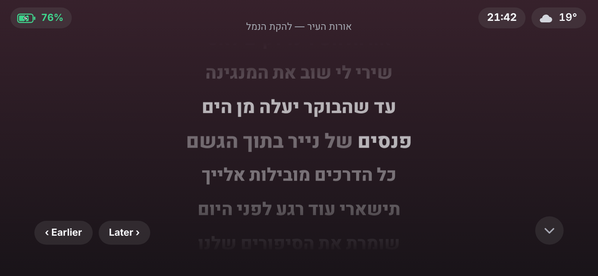

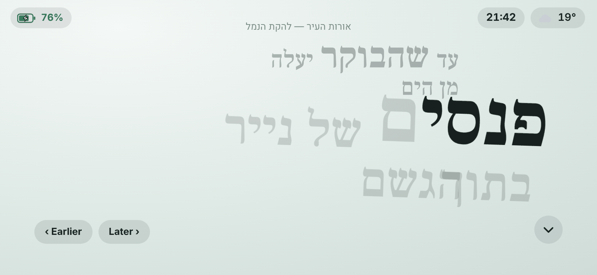

## [1.5.9] — 2026-11-07

### Changed
- **Top pills line up:** battery, source, time and weather pills share one height and an even 8 px gap. In Immersive,
  the source pill (Spotify, YouTube…) sits right after the battery pill whatever width the battery reading has.

### Screenshots
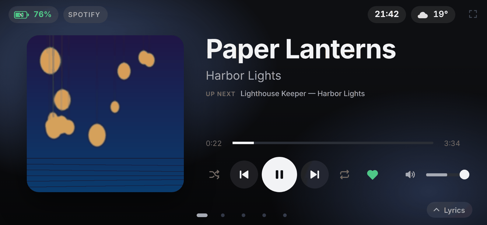

## [1.5.8] — 2026-11-07

### Changed
- **Immersive layout as an album card:** a big cover on the left; title, artist, progress and controls aligned to one
  edge on the right, with the progress bar inline (time · bar · length). Each text still reads in its own direction,
  so Hebrew and English titles share the same edge.

### Screenshots

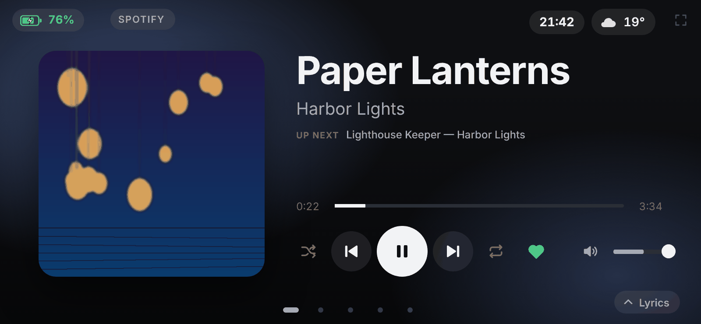

## [1.5.7] — 2026-11-07

Lyrics that stay in sync.

### Added
- **Earlier / Later buttons** on the lyrics screen shift the current song's lyrics; the shift is remembered per song on
  that phone.
- **Lyrics timing slider** under *Phone display* moves all lyrics earlier or later (±1.5 s).

### Changed
- **Smooth playback clock:** players report their position only every few seconds and slightly off, so the phone keeps
  its own running clock and nudges it toward each report instead of jumping back and forth. Seeks, new songs and
  play/pause still reset it at once.
- **Real line pacing:** a line is lit for most of the gap to the next line, but not stretched over long instrumental
  breaks.

### Screenshots

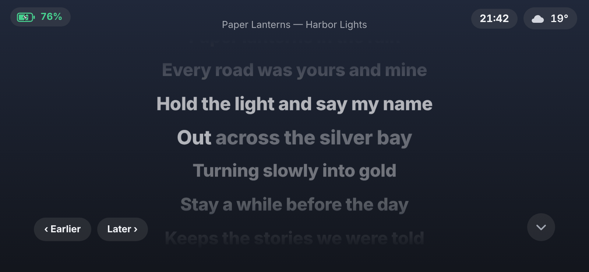
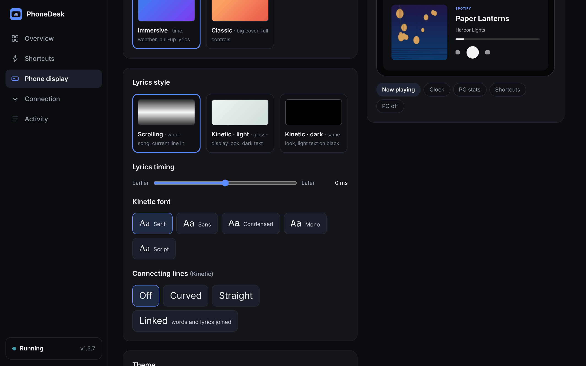

## [1.5.5] — 2026-11-07

### Added
- **Right-to-left lyrics** (Hebrew, Arabic): correct word order, right alignment, word fill running right to left,
  and RTL-aware titles, in both the scrolling and Kinetic styles.

### Screenshots

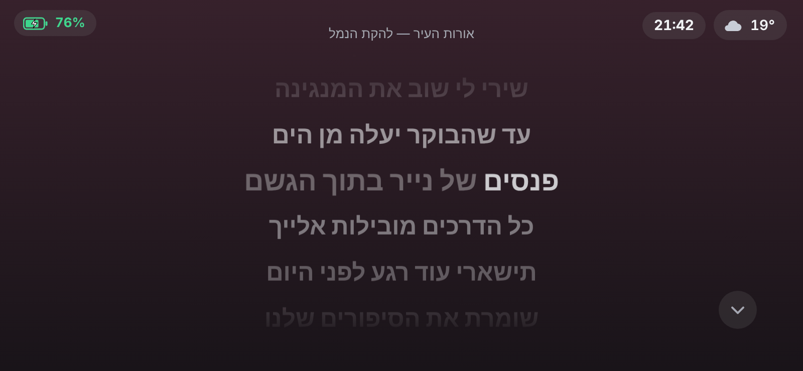
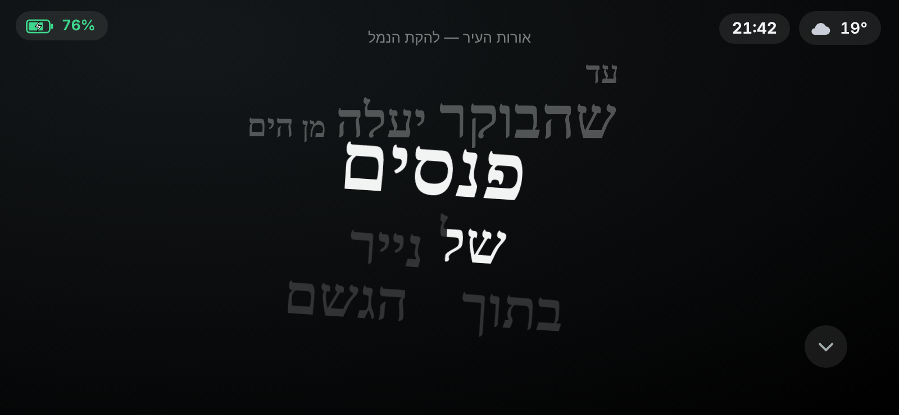

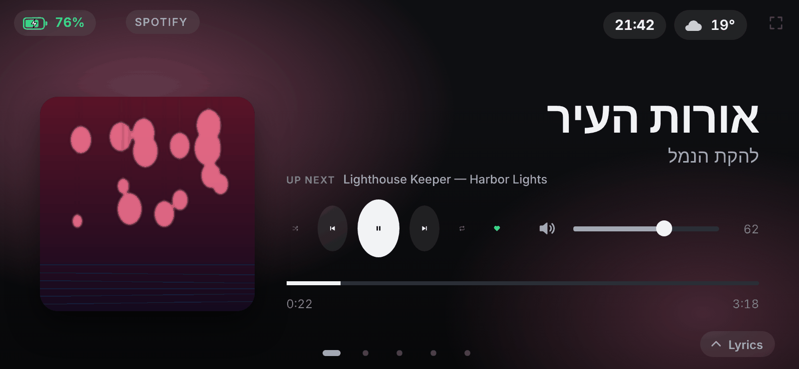

## [1.5.4] — 2026-11-07

### Changed
- **Linked lines** replace the Glass hairlines and word map: every word is joined to the next, and a thread runs from
  the last word of one lyric to the first word of the next, so the whole song reads as one continuous line. (Chosen
  with *Connecting lines → Linked*.)

### Screenshots
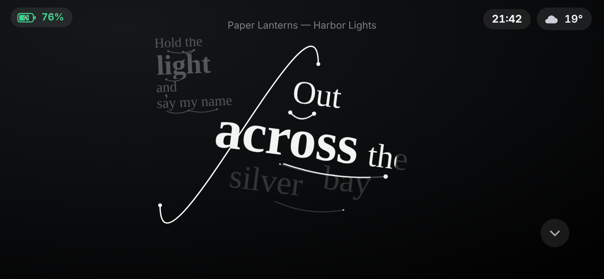

## [1.5.3] — 2026-11-07

### Added
- **Glass lines** for Kinetic lyrics: thin hairlines sweeping across the screen, a "word map" of tiny upper-case words
  joined by dotted lines in the free space, and a bold slanted slash that travels along the line as it's sung.

### Screenshots
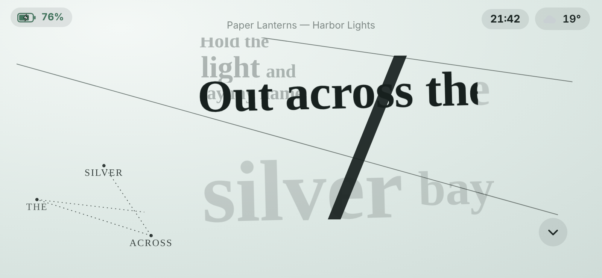

## [1.5.2] — 2026-11-07

### Added
- **Connecting lines** for Kinetic lyrics (*Phone display → Connecting lines*): a dot under each word and a line that
  draws from word to word as they're sung, **Curved** or **Straight** (or Off).

### Changed
- Lines drift slowly while shown, and words land with a springier motion.

### Screenshots

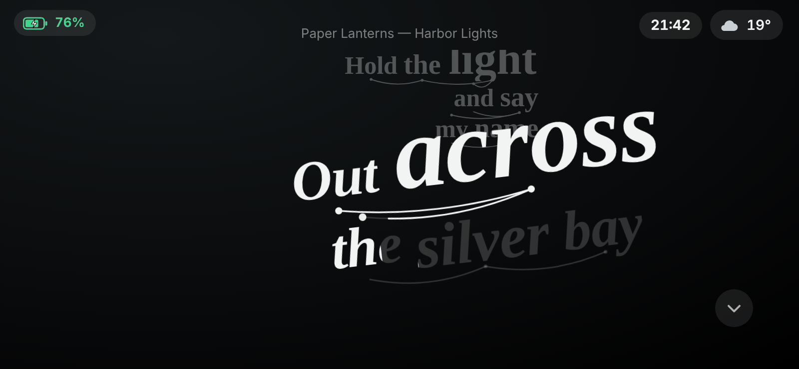
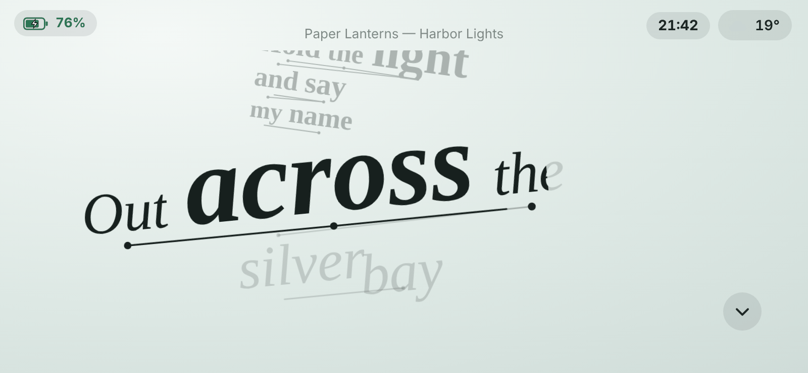

## [1.5.1] — 2026-11-07

Kinetic lyrics, part three.

### Added
- **Kinetic · dark**: the same look as light text on near-black, next to **Kinetic · light** (frosted glass, dark text).
- **Kinetic font** choice: Serif, Sans, Condensed, Mono or Script.

### Changed
- **Per-word fill:** each word starts as a ghost and fills with ink left to right, taking as long as the word takes to
  sing; each word slides in from its own random side.
- **Random layouts:** ragged rows of 1–3 words (never a lone word at the end), with one or two emphasis words among the
  longer ones.
- **Always on screen:** the laid-out (and tilted) text is measured, shrunk if too big and slid back inside if it pokes
  out.
- The corner pills turn dark only once the light sheet has settled.

### Screenshots

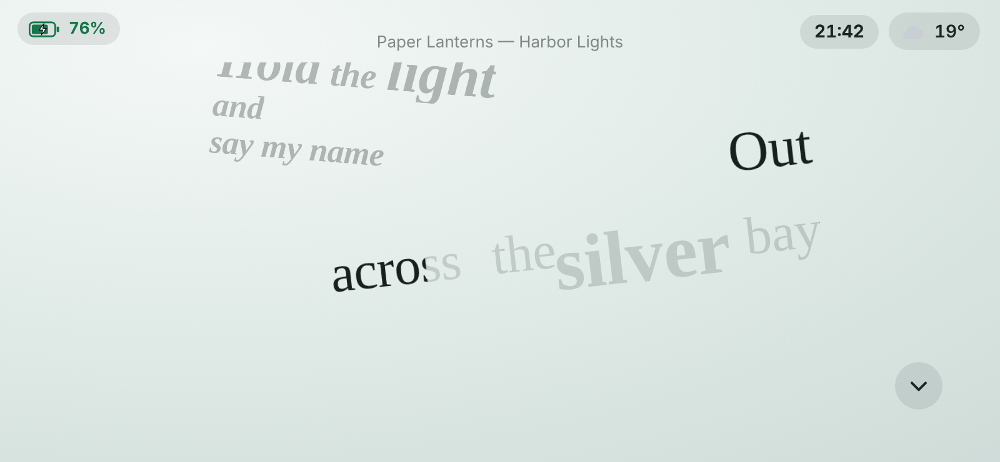
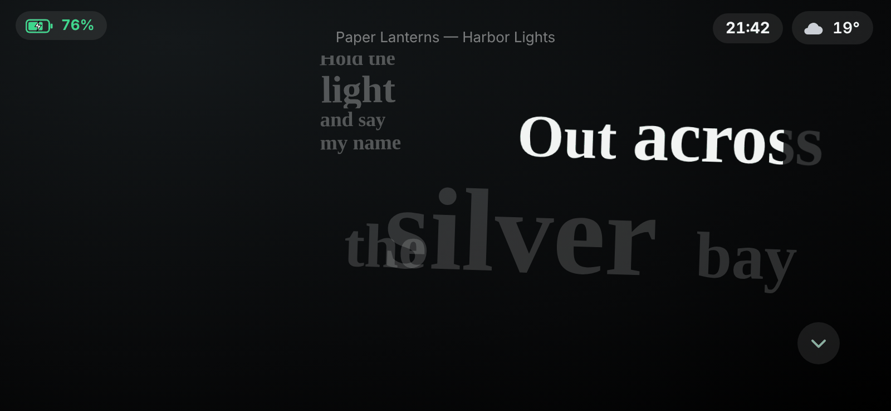

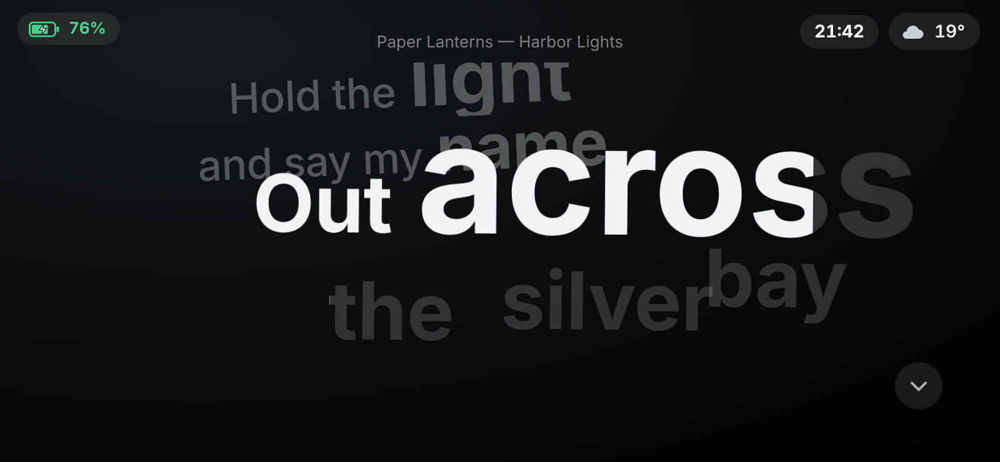
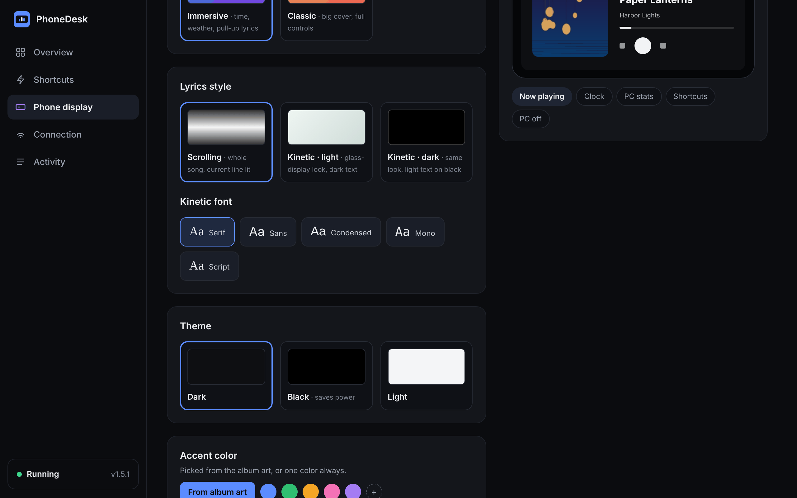

## [1.4.9] — 2026-11-07

### Changed
- **Kinetic lyrics redone as a glass-display look:** dark serif type on light frosted glass, ragged stacks of short
  rows, the longest word as the emphasis, ghost words for what's coming, and the previous line shrunk to a faint echo
  (one tucked above, one turned along the edge). Calm lines are lighter and wider; intense ones snap in as upper-case
  sans.

### Screenshots
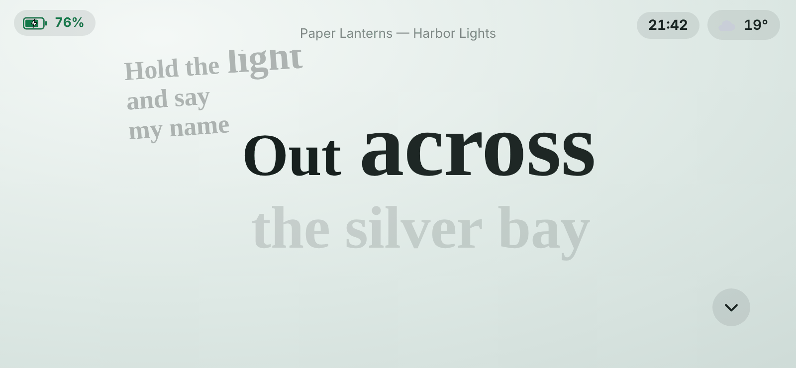

## [1.4.8] — 2026-11-07

### Added
- **Kinetic lyrics style**, selectable under *Phone display → Lyrics style*: one big line at a time, words appearing as
  they're sung, with calm, mid and "hot" motion depending on the line, and a quiet screen during long pauses.
  *Scrolling* (the whole song, current line lit) stays the default.

### Screenshots

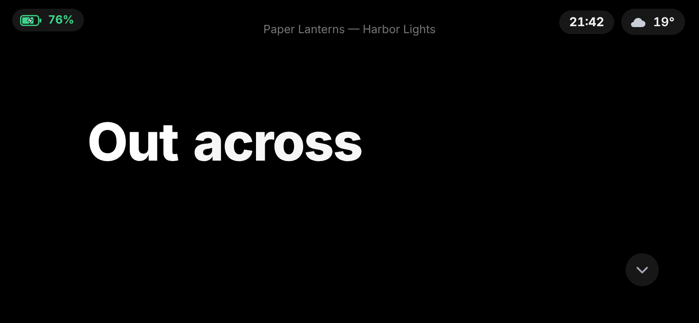
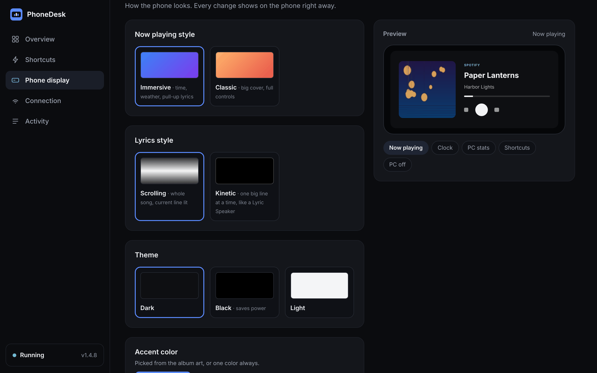

## [1.4.6] — 2026-11-07

### Changed
- **Per-word lighting** in the lyrics: the sung words light up one by one instead of a fill sweeping the line.
- **Pill-style top bar:** battery and source on the left, time and weather on the right, each in its own pill.
- Lyrics sheet: the song name is centred between the pills and the close arrow sits where the Lyrics pill was.

### Screenshots

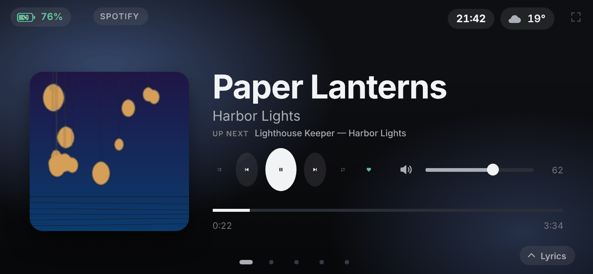
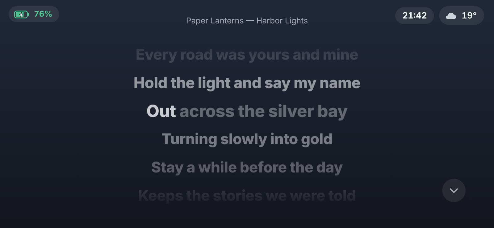

## [1.4.5] — 2026-11-07

### Added
- **Karaoke-style lyrics:** the current line fills word by word, paced by how long it's sung; three dots fill in and
  breathe during instrumental breaks.
- **Tap a line to seek** the song there.

### Changed
- Tighter sync: lines light a touch early (0.28 s), like the big players; finding the current line is a binary search.
- **Better song matching** on LRCLIB: exact match with album and length first, then without the album, then searches;
  synced lyrics must be within 6 s of the song's length, plain ones within 12 s. "(feat. …)" credits and
  "- Remastered / Live / Radio Edit / Remix…" suffixes are stripped from titles before searching.

### Screenshots
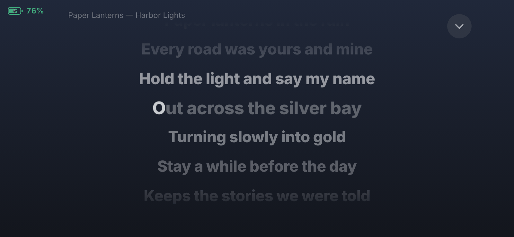

## [1.4.3] — 2026-11-07

### Fixed
- **One entry per phone:** Wireless debugging lists a phone twice (ip:port and an mDNS name); the duplicate is ignored.
- Auto-connect launches the PhoneDesk phone app when it's installed, instead of opening a browser page.

## [1.4.2] — 2026-11-07

### Changed
- **Tidier Immersive layout:** a bigger cover, title/controls/volume/progress on a grid, larger touch targets, and the
  clock and weather hugging the top-right corner.

### Screenshots
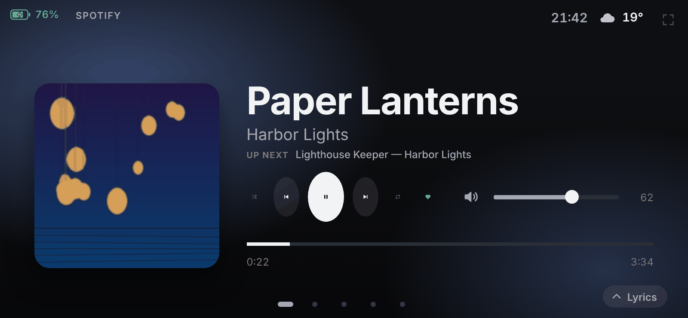

## [1.4.1] — 2026-11-07

### Changed
- The phone app draws behind the camera cutout/notch instead of leaving a black bar next to it.
- The fullscreen button is hidden inside the phone app (it's always full screen).

## [1.4.0] — 2026-11-07

The PhoneDesk phone app.

### Added
- **Android phone app** (`PhoneDesk.apk`, served by the PC at `/phone/PhoneDesk.apk`): a full-screen, always-on kiosk
  window onto PhoneDesk. It finds the PC by itself (phonedesk.local via its own mDNS lookup, or a saved address),
  follows the PC if its address changes, keeps the screen awake, locks landscape, ignores Back, and shares the battery
  level (which browsers don't do over plain http).
- *Connection → Connect a phone* has an **Install the phone app (recommended)** section.
- `build/android.ps1` builds the APK.

### Screenshots

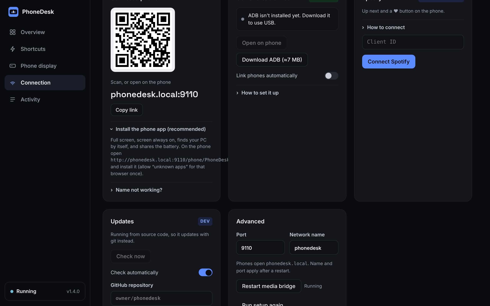
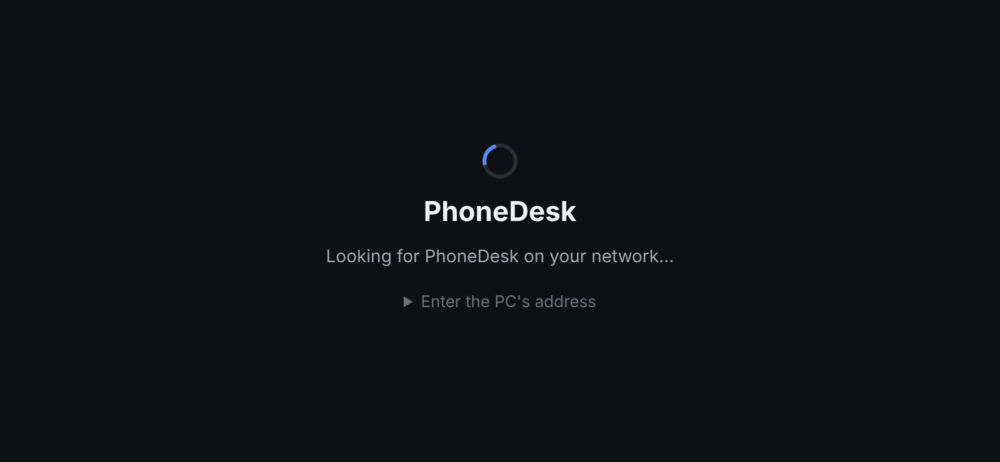

## [1.3.7] — 2026-11-07

### Added
- The phone sends a one-off diagnostic line to the PC's log (secure context, battery API, kiosk interface), to help
  diagnose a missing battery.

## [1.3.6] — 2026-11-07

### Added
- **Battery from Fully Kiosk Browser** through its JavaScript interface, for browsers without the battery API.
- The battery help text explains how to turn that on.

## [1.3.5] — 2026-11-07

### Fixed
- The volume slider in the dashboard's Now playing card no longer overflows on narrow windows.
- The *Switch screen* menu opens upward, so it's no longer cut off the screen; it no longer lists Lyrics in the
  Immersive style (lyrics are a pull-up sheet there).

### Added
- **"Why is the battery missing?"** help on the Overview when the phone doesn't share it.

### Screenshots
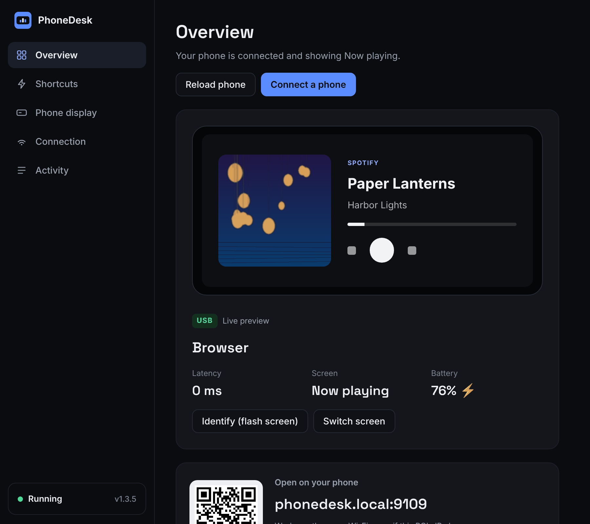

## [1.3.4] — 2026-11-07

### Fixed
- Round icon buttons in the dashboard stay round instead of squashing into ovals.

## [1.3.3] — 2026-11-07

Immersive Now playing.

### Added
- **Immersive Now playing style** (new default): a tinted background, cover and big title, time and weather in the
  corner, and a **Lyrics** pill that pulls the lyrics up as a sheet over the screen (swipe up to open, down to close).
- **Classic** (big cover, full controls) stays selectable under *Phone display → Now playing style*.

### Screenshots

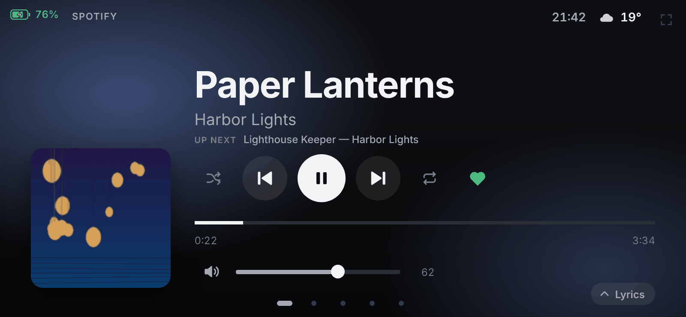
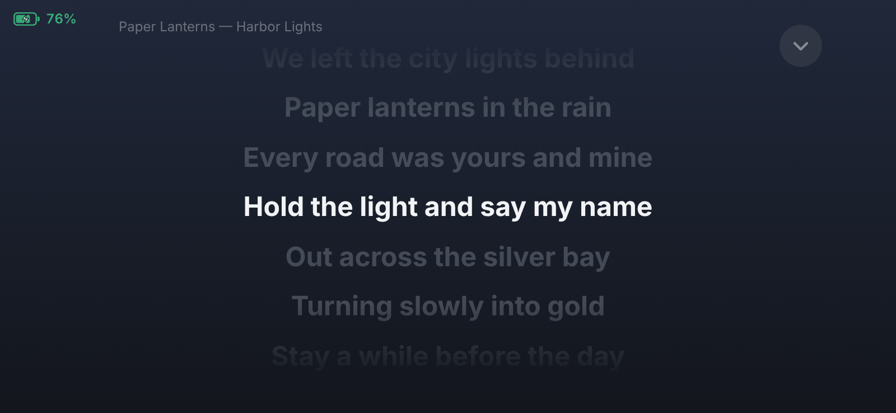

## [1.3.2] — 2026-11-07

### Changed
- **Compact Connection page:** a *Your phones* list (device, current screen, link type, latency, battery, Identify
  button), one *Connect a phone* card, one *USB and cable-free* card, and setup steps folded into "How to…" sections.

### Fixed
- App icons are no longer mirrored or upside down (GDI is always asked for top-down rows).
- Icons are found for more notification apps (ids like `com.squirrel.Discord.Discord`, or apps that aren't running, via
  their Start menu shortcut).

### Screenshots

## [1.3.1] — 2026-11-07

### Changed
- **Smoother animations** everywhere (they respect *reduce motion*):
  - screens slide in the swipe direction;
  - the old cover stays until the new one has loaded, then the new one fades and settles in, with a light sweep while
    loading; title, artist and app slide up on track changes; the background tint cross-fades;
  - notification banners drop in with a spring, show a time-left bar, and slide out;
  - the ♥ button pops;
  - dashboard pages and cards fade up in sequence; buttons press in.

## [1.3.0] — 2026-11-07

Mixer, lyrics, weather, Spotify, notifications, GPU.

### Added
- **Volume mixer** screen: per-app volume and mute (Windows audio sessions) with app icons.
- **Lyrics** screen: synced lyrics from [LRCLIB](https://lrclib.net), highlighted line by line.
- **Weather** on the clock, from Open-Meteo (your city, or an approximate location).
- **GPU stats** on the PC stats screen: load, temperature, hotspot, power, VRAM (AMD via ADL, NVIDIA via
  `nvidia-smi`).
- **Spotify:** a ♥ button to save the song and "up next" (Web API, PKCE sign-in, no secret stored).
- **PC notifications** on the phone as banners, with app icon and name; private mode hides their text.
- **First-run setup wizard:** connect the phone, check and fix Windows Firewall for Wi-Fi, choose weather,
  notifications and start-with-Windows.
- **Auto-update from GitHub Releases** with SHA-256 verification; the installer runs silently and restarts PhoneDesk.
  The build writes a `.sha256` next to the installer.

### Fixed
- Microsoft Store apps get their real names and icons; path-style app ids resolve.
- New screens are added once, in order, to existing setups.

### Screenshots

## [1.2.0] — 2026-11-07

A real desktop app and a redesigned dashboard.

### Added
- **Desktop window** (WebView2) with a dark native title bar; closing it keeps PhoneDesk in the tray, and launching it
  again brings the window forward. Dark tray menu and "phone connected" notifications.
- **New icon** for the app, tray, favicon and phone home screen.
- **Rebuilt dashboard:** Overview with a live phone preview, latency, battery, Identify and Switch screen; a Shortcuts
  editor on a phone-shaped grid with key recording; Phone display settings with a live preview; Connection and
  Activity pages; bundled fonts so it works offline.
- **Battery icon** on the phone (from the browser, or read by the PC over ADB).
- Icon of the playing app next to the source (real app and game icons, YouTube detection).
- Optional network-ADB link for phones on a charger; start-with-Windows toggle in the app.

### Changed
- The phone falls back between USB, phonedesk.local and the PC's IP without reloading, so unplugging USB keeps it
  working over Wi-Fi.
- The screen is kept on with Android's *Stay awake*; the wake lock is re-acquired.
- Discord (configurable) is ignored when choosing the media source.

### Fixed
- Album art never loading (WinRT stream conversion failed). Missing art is looked up in the iTunes catalog, with an
  artist check.

### Screenshots

## [1.1.0] — 2026-11-07

Windows installer, tray app and phonedesk.local.

### Added
- **PhoneDesk.exe tray app:** runs the server hidden, restarts it if it crashes, starts with Windows, stops the server
  if the tray app dies (job object), detects and fixes Windows Firewall blocks, and doubles as the uninstaller.
- **PhoneDesk-Setup.exe:** per-user installer with a bundled Node runtime; in-place updates keep settings; optional
  one-time firewall rule. Built with the C# compiler that ships with Windows (`build/build.ps1`).
- **phonedesk.local:** an mDNS responder, so phones reach the PC by name even when its IP changes; also listens on
  port 80 so no port is needed.
- Settings live in `%APPDATA%\PhoneDesk` when installed.
- Phone: when the PC connection drops, a **full-screen clock** with a small reconnecting status replaces the
  "Connecting" screen.

### Changed
- The phone is always landscape: upright phones get a rotated layout (touch, sliders and swipes mapped to match); the
  first tap goes full screen and asks for a landscape lock where the browser allows it.

### Screenshots

## [1.0.0] — 2026-11-07

First version: a lightweight desk display for Windows, made to run smoothly on old Android phones.

### Added
- Node server plus a plain-JS phone client.
- Windows media (SMTC), volume and key presses through a supervised PowerShell bridge that restarts itself if it
  crashes or hangs.
- Phone screens: Now playing, clock, PC stats and shortcut buttons.
- Browser dashboard on the PC: connect by QR code or USB, shortcut editor, settings and logs.
- USB auto-connect through `adb reverse`.

### Screenshots

[1.8.1]: https://github.com/icdmkg2/phonedesk/releases/tag/v1.8.1
[1.8.0]: https://github.com/icdmkg2/phonedesk/releases/tag/v1.8.0
[1.7.3]: https://github.com/icdmkg2/phonedesk/releases/tag/v1.7.3
[1.7.2]: https://github.com/icdmkg2/phonedesk/releases/tag/v1.7.2
[1.7.1]: https://github.com/icdmkg2/phonedesk/releases/tag/v1.7.1
[1.6.4]: https://github.com/icdmkg2/phonedesk/releases/tag/v1.6.4
[1.6.3]: https://github.com/icdmkg2/phonedesk/releases/tag/v1.6.3
[1.6.1]: https://github.com/icdmkg2/phonedesk/releases/tag/v1.6.1
[1.6.0]: https://github.com/icdmkg2/phonedesk/releases/tag/v1.6.0
[1.5.9]: https://github.com/icdmkg2/phonedesk/releases/tag/v1.5.9
[1.5.8]: https://github.com/icdmkg2/phonedesk/releases/tag/v1.5.8
[1.5.7]: https://github.com/icdmkg2/phonedesk/releases/tag/v1.5.7
[1.5.5]: https://github.com/icdmkg2/phonedesk/releases/tag/v1.5.5
[1.5.4]: https://github.com/icdmkg2/phonedesk/releases/tag/v1.5.4
[1.5.3]: https://github.com/icdmkg2/phonedesk/releases/tag/v1.5.3
[1.5.2]: https://github.com/icdmkg2/phonedesk/releases/tag/v1.5.2
[1.5.1]: https://github.com/icdmkg2/phonedesk/releases/tag/v1.5.1
[1.4.9]: https://github.com/icdmkg2/phonedesk/releases/tag/v1.4.9
[1.4.8]: https://github.com/icdmkg2/phonedesk/releases/tag/v1.4.8
[1.4.6]: https://github.com/icdmkg2/phonedesk/releases/tag/v1.4.6
[1.4.5]: https://github.com/icdmkg2/phonedesk/releases/tag/v1.4.5
[1.4.3]: https://github.com/icdmkg2/phonedesk/releases/tag/v1.4.3
[1.4.2]: https://github.com/icdmkg2/phonedesk/releases/tag/v1.4.2
[1.4.1]: https://github.com/icdmkg2/phonedesk/releases/tag/v1.4.1
[1.4.0]: https://github.com/icdmkg2/phonedesk/releases/tag/v1.4.0
[1.3.7]: https://github.com/icdmkg2/phonedesk/releases/tag/v1.3.7
[1.3.6]: https://github.com/icdmkg2/phonedesk/releases/tag/v1.3.6
[1.3.5]: https://github.com/icdmkg2/phonedesk/releases/tag/v1.3.5
[1.3.4]: https://github.com/icdmkg2/phonedesk/releases/tag/v1.3.4
[1.3.3]: https://github.com/icdmkg2/phonedesk/releases/tag/v1.3.3
[1.3.2]: https://github.com/icdmkg2/phonedesk/releases/tag/v1.3.2
[1.3.1]: https://github.com/icdmkg2/phonedesk/releases/tag/v1.3.1
[1.3.0]: https://github.com/icdmkg2/phonedesk/releases/tag/v1.3.0
[1.2.0]: https://github.com/icdmkg2/phonedesk/releases/tag/v1.2.0
[1.1.0]: https://github.com/icdmkg2/phonedesk/releases/tag/v1.1.0
[1.0.0]: https://github.com/icdmkg2/phonedesk/releases/tag/v1.0.0
