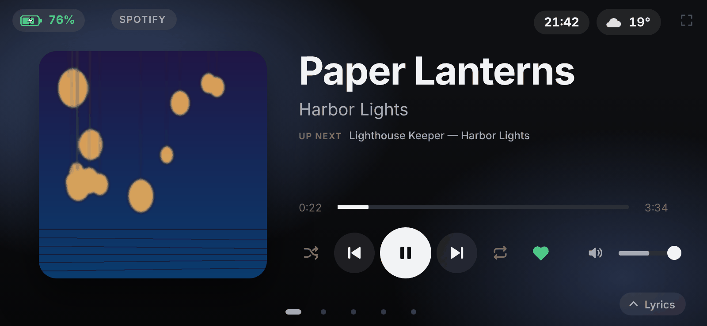
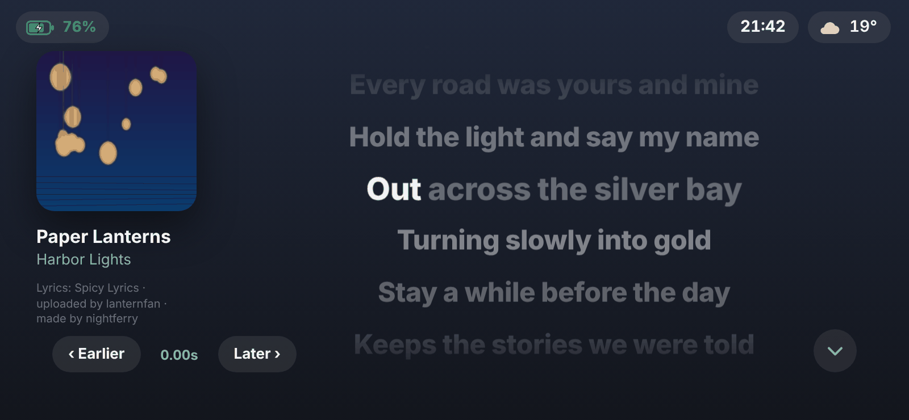
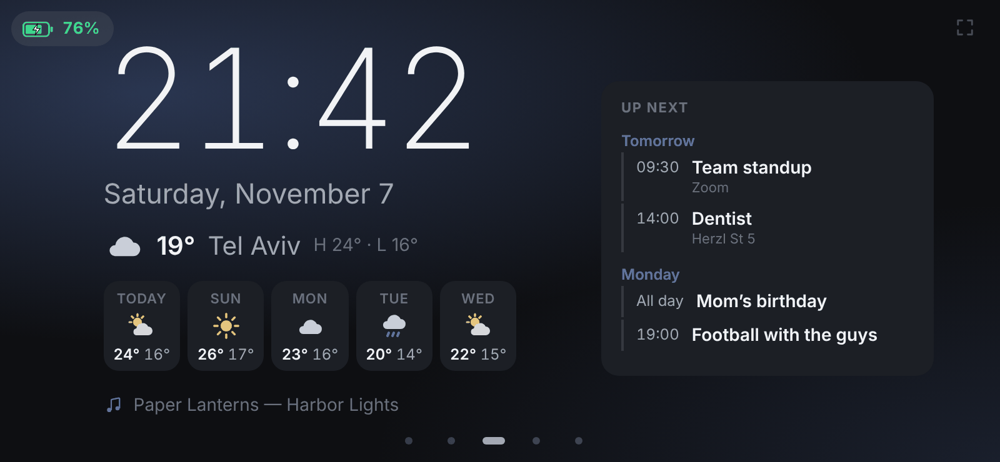
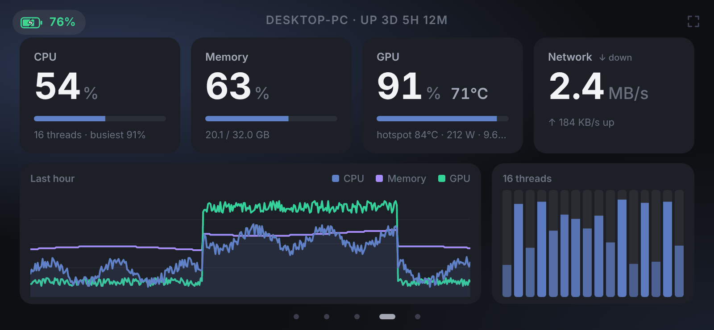
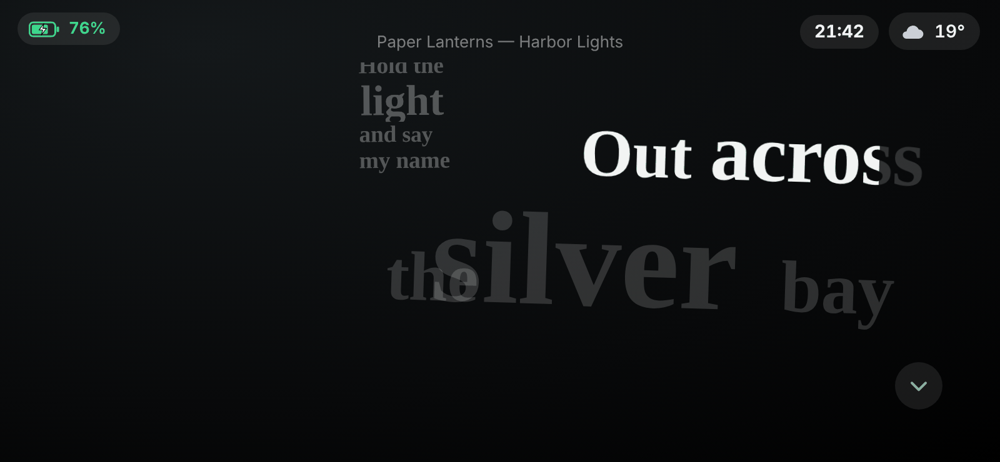
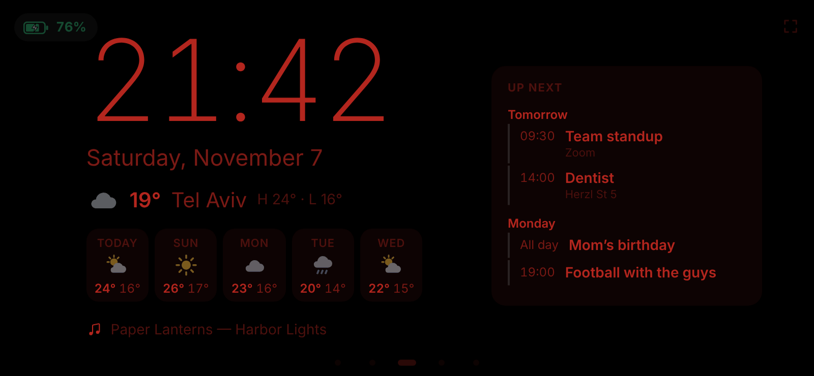
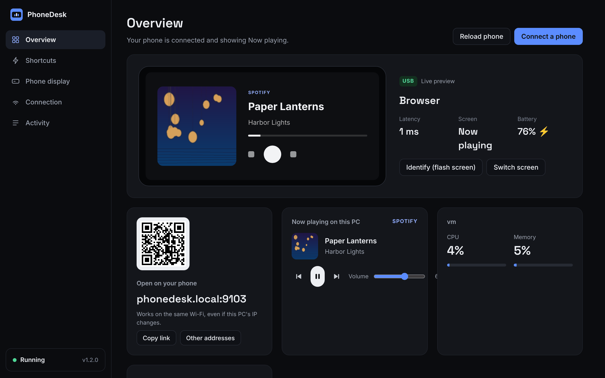

# PhoneDesk

**Turn an old Android phone into a desk display for your Windows PC**: now playing with album art and synced
lyrics, media and volume controls, a clock with weather and your calendar, live PC stats, and a pad of shortcut
buttons. Built and tuned for a Samsung Galaxy A11, light enough for any old phone. A lighter take on the DeskThing idea.

[**Download the latest release**](https://github.com/icdmkg2/phonedesk/releases/latest) ·
[Website](https://icdmkg2.github.io/phonedesk/) ·
[What's new](CHANGELOG.md) ·
[Report a problem](https://github.com/icdmkg2/phonedesk/issues/new/choose)

<p>


</p>
<p>


</p>
<p>


</p>



## Features

- **Now playing** from any app that uses Windows media controls (Spotify, browsers and YouTube, Media Player…): cover
  art, controls, volume, Spotify ♥ and up next. Immersive or Classic style.
- **Lyrics**: word-by-word synced lyrics (Spicy Lyrics, LRCLIB), scrolling or Kinetic styles, right-to-left languages,
  timing you can nudge per song.
- **Clock**: digital, analog or big; weather with a 5-day forecast; your next events from Google, Outlook or iCloud.
- **PC stats**: CPU (and every core), memory, GPU, network speed, and the last hour as a graph.
- **Mixer** with per-app volume, **PC notifications** as banners, and a **shortcut pad** (keys, links, apps).
- **Night mode** (on a schedule or when the room is dark) and **burn-in protection** for phones that stay on all day.
- Connects over **USB or Wi-Fi**, finds the PC by itself (`phonedesk.local`), and **updates itself** from GitHub Releases.

## Install

Download **`PhoneDesk-Setup-x.y.z.exe`** from the [latest release](https://github.com/icdmkg2/phonedesk/releases/latest) and run it. It installs for your Windows account only and needs no admin rights. Node.js comes bundled, so you don't need to install it.

- PhoneDesk opens as its **own window** (it uses the Edge WebView2 engine that comes with Windows 11). Closing the window keeps PhoneDesk running in the **tray**, near the clock; click the tray icon to bring it back, right-click it for the menu.
- The window has: **Overview** (a live preview of what the phone shows, its connection, latency and battery), **Shortcuts** (edit the buttons by clicking them on a phone-shaped grid, record keys by pressing them), **Phone display** (theme, accent, clock, dimming, screens, battery icon, album-art lookup), **Connection** and **Activity**.
- It starts with Windows and runs quietly in the background. If the server ever crashes, the tray app restarts it.
- The installer offers to let phones on your Wi-Fi through Windows Firewall. That's the only step where Windows asks for permission.
- Updates install by themselves (*Connection → Updates*), or run a newer setup. Your settings are kept, and the new version's notes show once.
- To uninstall, use Windows Settings → Apps → PhoneDesk.

Windows SmartScreen may warn about the setup because it isn't code-signed. Choose *More info → Run anyway*.

Settings are stored in `%APPDATA%\PhoneDesk`, and logs in `%APPDATA%\PhoneDesk\logs`.

### Run from source instead

Double-click **`start.bat`** (needs Node.js 18+). The dashboard opens at http://localhost:8765.

### Build the installer

```
powershell -ExecutionPolicy Bypass -File build\build.ps1
```

This writes `dist\PhoneDesk-Setup-<version>.exe`. It uses only the C# compiler that comes with Windows plus your installed Node.js, which it copies in as the bundled runtime.

## Connect the phone

**USB (recommended)**
1. On the phone: Settings → About phone → Software information → tap *Build number* 7 times.
2. Settings → Developer options → turn on **USB debugging**.
3. Plug the phone in and accept the "Allow USB debugging" prompt.

PhoneDesk links the phone and opens itself on the phone's browser. If ADB isn't installed, the dashboard has a button that downloads it from Google.

**Wi-Fi**
On the phone, open **http://phonedesk.local** in the browser, or scan the QR code on the dashboard. The phone must be on the same network as the PC.

`phonedesk.local` always points at the PC, even when the router gives it a new IP address. PhoneDesk announces the name on your local network (mDNS), so there's nothing to set up on the router. You can rename it in `config.json` (`"name"`) if you have more than one PC.

If the phone can't connect, right-click the tray icon and choose *Let phones on Wi-Fi connect…*.

On the phone, tap the ⤢ button in the corner for full screen, or use Chrome's menu → *Add to Home screen*.

## Why it's lighter than DeskThing

| | DeskThing | PhoneDesk |
|---|---|---|
| PC app | Electron (a whole Chromium) | One small Node process, with the dashboard in your normal browser |
| If media reading breaks | Can take the app down | Runs in its own helper process that restarts itself; the server keeps going |
| Phone UI | React app | Plain JS and CSS, about 45 KB total, no framework |
| Progress bar | Re-rendered by JS | One CSS transition per track change, run by the GPU |
| Album art | Sent over the socket | Cached URL, downloaded once per track |
| Connection drops | Often needs a restart | Reconnects with backoff, detects dead sockets, resumes on screen wake |

Other things that keep it fast on old phones:
- Only the visible screen does any work. The clock ticks only while it's on screen.
- No blur, backdrop filters or large shadows.
- Volume drags are throttled, and play/pause flips the icon instantly before the PC confirms.

## Phone screens

Swipe between them; pick and order them in *Phone display*.

- **Now playing:** album art, the playing app's icon, controls, volume. With Spotify connected: ♥ and *up next*.
- **Lyrics:** synced lyrics from [LRCLIB](https://lrclib.net), highlighted line by line.
- **Volume mixer:** a slider and mute button per app (Spotify, the browser, Discord, games…), like Windows' Volume Mixer.
- **Clock:** big time and date, weather (Open-Meteo; your city or an approximate location), the current song.
- **PC stats:** CPU, memory, volume, and GPU load/temperature/power (AMD through the driver, NVIDIA through `nvidia-smi`). CPU temperature and FPS need admin access in Windows, so they're not shown.
- **Shortcuts:** your buttons.

PC notifications (Discord, WhatsApp, mail…) pop up on the phone for a few seconds. *Private* mode shows only which app.

## Spotify (optional)

Spotify only lets registered apps read your queue and library, so this needs a free developer app (two minutes):
open *Connection → Spotify* in PhoneDesk and follow the three steps there. Sign-in uses PKCE, so no secret is stored.

## Updates

PhoneDesk updates itself from the releases of [icdmkg2/phonedesk](https://github.com/icdmkg2/phonedesk/releases) by default (checked a minute after start and every 6 hours). To use a fork, set *Connection → Updates → GitHub repository* to `owner/repo`; an empty field means the official releases, and *Check automatically* turns updates off.
Each release needs the `PhoneDesk-Setup-x.y.z.exe` that `build\build.ps1` makes; GitHub adds a SHA-256 digest automatically
(or upload the `.sha256` file next to it). PhoneDesk refuses downloads whose checksum doesn't match.

What changed in each version is in [CHANGELOG.md](CHANGELOG.md) (with screenshots of interface changes) and on
[GitHub Releases](https://github.com/icdmkg2/phonedesk/releases). *Connection → Updates* links to the notes of the version
you run and of a downloaded update.

Releases are published by `.github/workflows/release.yml`: bump the version in `package.json` and
`installer/Common.cs`, add a `## [x.y.z] — date` section to `CHANGELOG.md` (screenshots go in
`docs/changelog/x.y.z/`), and merge to `main`. The workflow builds the installer on Windows and creates release
`vx.y.z` with those notes and the `.exe` + `.sha256`. Versions in the changelog without a release get a notes-only
release, and editing the changelog refreshes existing release notes. `node build/release.js notes x.y.z` prints a
version's notes.

## Phone on a charger (no cable to the PC)

- **Screen always on:** once the phone has been plugged in by USB with PhoneDesk running, Android's *Stay awake* setting is switched on. It stays on afterwards, so the screen never sleeps while the phone is charging.
- **Battery icon and auto-reopen over Wi-Fi:** turn on *Developer options → ADB over network* (LineageOS) or *Wireless debugging*. When the phone opens PhoneDesk over Wi-Fi, the PC links to it, shows its battery, keeps the screen on and reopens PhoneDesk on it after a restart. Accept the "Allow debugging" prompt once.

## Album art

PhoneDesk shows the picture the music app gives Windows (Spotify, Media Player, …). When an app gives none (YouTube in a browser), PhoneDesk looks the song up in the iTunes catalog by artist and title, and only uses a result whose artist matches. Turn it off in *Phone display → Extras*.

## Shortcuts

In the dashboard, open the **Shortcuts** tab. Each button can do one of three things:
- **Press keys**, such as `ctrl+shift+m`, `win+d`, `alt+f4`, `f5` or `medianext`
- **Open a link**, either a web page or an app link like `spotify:` or `discord://`
- **Start an app**, using a full path to an `.exe`

## Files

```
server/index.js        HTTP + WebSocket server, API for the dashboard
server/bridge-win.ps1  Windows media (SMTC), volume and key presses; its own process
server/bridge.js       Restarts the bridge if it crashes or hangs
server/adb.js          USB auto-connect (adb reverse)
server/mdns.js         Answers "phonedesk.local" on the local network
server/artwork.js      Finds album art online when the app gives none
server/lyrics.js       Synced lyrics (LRCLIB)
server/weather.js      Weather (Open-Meteo)
server/spotify.js      Spotify up next + like (Web API, PKCE)
server/notify.js       Reads new Windows notifications
server/updater.js      Auto-update from GitHub Releases
server/calendar.js     Upcoming events from an iCal (.ics) address
server/changelog.js    Patch notes for What's new (and the website)
server/diagnostics.js  The diagnostics zip for bug reports
server/firewall.js     Wi-Fi firewall check for first-run setup
installer/Window.cs    The PhoneDesk window (WebView2)
installer/Tray.cs      PhoneDesk.exe: tray app, server supervisor, uninstaller
installer/Setup.cs     PhoneDesk-Setup.exe
build/build.ps1        Builds the installer
build/release.js       Release notes from CHANGELOG.md for GitHub Releases
.github/workflows/     release.yml: builds and publishes GitHub Releases
CHANGELOG.md           Patch notes for every version (screenshots in docs/changelog/)
site/                  The website (node site/build.js → site/dist, published to GitHub Pages)
public/phone/          The phone app
public/dashboard/      The PC dashboard
data/config.json       Your settings when running from source (installed: %APPDATA%\PhoneDesk)
```

## Notes

- Media info comes from Windows' media controls, so Spotify, browsers (YouTube etc.), Media Player and most music apps work.
- Changing settings or the dashboard API only works from the PC itself. Anyone on your network who opens the phone page can control playback and press your shortcut buttons.
- Browsers only allow wake lock on secure origins. Over USB the phone uses `localhost`, which counts as secure, so the screen stays on. Over Wi-Fi, turn on Developer options → *Stay awake*.
